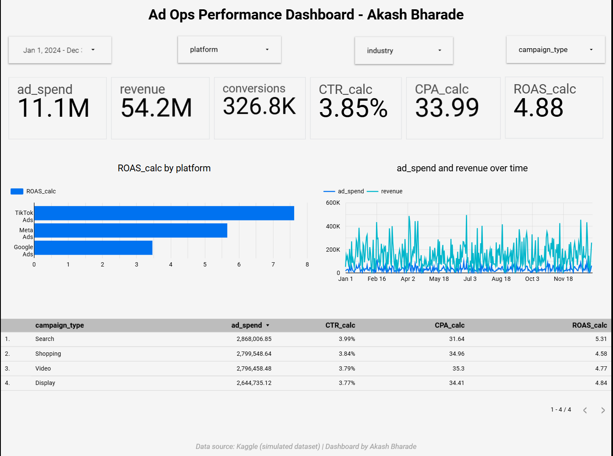
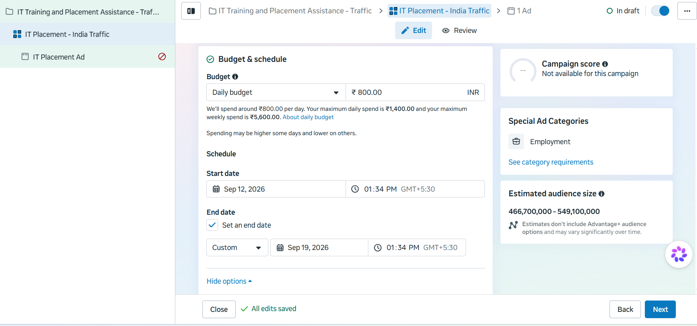
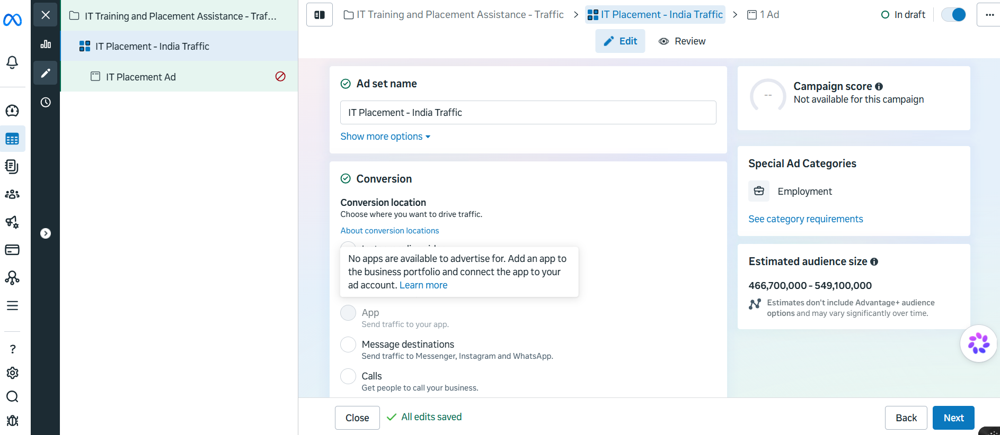
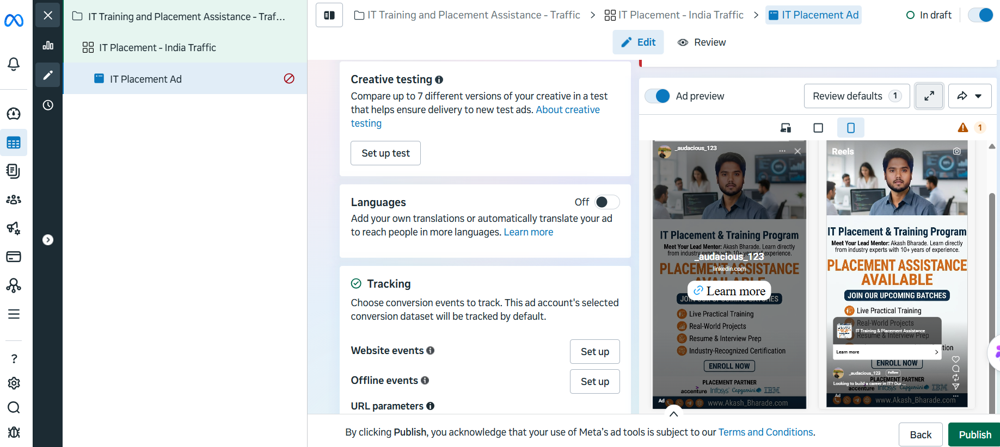

# 📊 Automated Ad Ops System Health, Performance & Paid Media Suite

A comprehensive, multi-module digital marketing operations suite engineered to monitor data pipelines, optimize cross-platform performance metrics, and build policy-compliant paid acquisition campaigns across **Meta, Google, and TikTok**.

---

## 🛠️ Interactive Assets & Core Modules
1. **[Live Asset 1: Infrastructure Diagnostic Portal](https://google.com)** — Focused on real-time pacing anomalies, tracking pixel drops, and system health.
2. **[Live Asset 2: Multi-Platform Performance Dashboard](https://google.com)** — Focused on campaign efficiency, cross-channel ROAS, and deeper funnel analytics.
3. **Module 3: Meta Ads Campaign Architecture** — End-to-end paid acquisition design for high-intent professional programs.

---

## 🛑 Module 1: System Health & Budget Leak Prevention

### 📊 Data Source: Simulated Data Pipeline
Built using a cross-channel **simulated data pipeline** designed to mimic real-world high-budget digital operations telemetry without exposing sensitive client information.

### 📷 Health Dashboard Preview

### The Problem: Silent Operational Killers
In high-budget digital operations, tracking pixels drop out unnoticed, or network delivery algorithms overspend by 25%—with performance teams often failing to catch the anomaly for up to 48 hours. This data fragmentation results in direct, unrecoverable revenue loss.

### Core Automation Features:
* **🚨 Critical Overspend Tracker:** Employs dynamic calculated monitoring logic (`CASE WHEN`) to immediately flag campaigns pacing **>10% over daily thresholds** by instantly highlighting rows in bright red.
* **🟠 Tracking Discrepancy Audits:** Computes real-time variance between ad network metrics and internal merchant databases to instantly surface server-side pixel drops (**>5% margin gaps**).
* **🎛️ Birds-Eye Executive Triage Blocks:** Consolidates active pipeline failures (such as *Disapproved Campaigns* and *Failed Tracking Scripts*) into single-screen summary counters for immediate operational triage.

---

## 📈 Module 2: Cross-Channel Performance Analytics

### 📊 Data Source: Kaggle Ad Ops Dataset
Engineered using a public **Kaggle multi-platform marketing dataset** containing real-world performance parameters to test deep-funnel channel efficiency at scale.

### 📷 Performance Dashboard Preview

### Data Scale & Methodology
Analyzed **1,000+ rows of multi-platform campaign data** across Google, Meta, and TikTok to decode efficiency drivers. Built with rigorous **Quality Assurance (QA) habits** where every calculated metric—including **CTR, CPA, and ROAS**—was thoroughly cross-validated against raw backend data totals before dashboard deployment.

### 💡 Data-Driven Key Insights:
* **Search vs. Shopping Efficiency:** Search campaigns delivered the highest efficiency at **5.31x ROAS**, whereas Shopping campaigns lagged at **4.58x ROAS**, despite both channels maintaining similar scale and spend thresholds (~**₹28 Lakhs each**).
* **Platform Dominance:** TikTok demonstrated superior efficiency, leading on platform-level ROAS metrics compared to other channels.

---

## 🎯 Module 3: Meta Ads Paid Acquisition Framework
*Strategic hands-on campaign built from scratch to demonstrate full-funnel performance marketing capabilities paired with analytical data processing.*

### 📷 Ad Creative & Campaign Architecture Preview

| 🎨 Ad Creative Design (High CTR) | ⚙️ Budget & Schedule Configuration |
| --- | --- |
|  |  |

| 🎯 Conversion Location Setup | 🔍 Tracking & Ad Preview |
| --- | --- |
|  |  |

### 🛠️ Campaign Configuration & Setup Strategy
* **Campaign Objective:** Engineered for **Traffic** optimization to drive high-intent visitors directly to a dedicated program landing page.
* **Budget Architecture:** Configured via a controlled daily budget strategy (set at **₹800.00/day**) integrated with precision-scheduled start/end dates to maximize initial delivery efficiency.
* **Audience Targeting Taxonomy:** Location-based targeting scaled across **India**, locking in an estimated potential reach of **466M - 549M+ users**.
* **Ad Asset Design:** Developed native-style ad creatives encompassing high-CTR vertical image assets (optimized for Stories/Reels), engaging primary text, high-intent headlines, and action-oriented Call-to-Actions (CTAs).

### ⚖️ Technical Compliance & Strategic Learnings
* **Special Ad Category Alignment (Employment):** Successfully navigated and declared Meta's **Special Ad Category** constraints. Gained deep understanding of how platform algorithm boundaries restrict audience demographic and lookalike targeting on job/housing-related ads to structurally prevent bias.
* **Objective Discrepancy Audits:** Mastered the structural differences between **Traffic vs. Lead Generation** objectives, specifically regarding conversion locations, CTA compatibility barriers, and mandatory Facebook Page Terms compliance.
* **Ad Policy Enforcement:** Standardized copy and compliance guardrails to entirely avoid "guaranteed result" claims, protecting active ad accounts from automated platform flags at the initial setup stage.

*(Note: Practice project — brand logos deployed strictly as design placeholder examples rather than commercial partnerships).*

---

## 🛠️ Tech Stack & Technical Competencies
* **Data Visualization & Analytics:** Looker Studio (Google Data Studio)
* **Paid Media Operations:** Meta Ads Manager (Facebook/Instagram), Audience Insights, Campaign Budget Optimization (CBO) strategy.
* **Data Verification & QA:** Cross-validation formulas, backend data reconciliation, and audit trailing.
* **Advanced Logic:** Custom Fields, Conditional Formatting, and `CASE WHEN` logical expressions.
* **Core Domains:** Performance Marketing Strategy, Budget Pacing, Compliance Guardrails, Tracking Validation, ROAS/CPA Optimization.

---
*Stop running manual platform audits. Build automated safety guardrails instead.*

